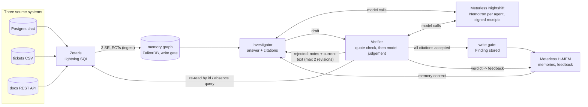

# What Leaves With Them

**Track:** 02, The Agent That Can Explain Why (Open Agent Hackathon 2026)
**Sponsor technology:** Zetaris (one SQL endpoint over Postgres chat, a tickets CSV and a docs REST API) · Meterless Nightshift (primary model provider, signed receipts) and the Meterless H-MEM engine (agent memory) · NVIDIA Nemotron (one model per agent, through Nightshift)
**Run:** `docker compose up --build`, then `curl -X POST localhost:8000/run -H 'content-type: application/json' -d @input_examples/02_tampered_source.json` (SAMPLE_MODE by default: no credentials, no network, no GPU)

When a colleague leaves, a team lead has to find out who owns what now and why, from chat, tickets and documents that disagree. Two agents answer that kind of question. The Investigator answers from a memory graph and cites a record id and one quoted line for every claim. The Verifier re-reads each cited record through Zetaris, from the system it lives in, and rejects a quote that is not there any more. The Investigator then has to revise. Only an answer whose every citation survived is stored.

In a 2022 survey of 1,000 IT managers at large organizations in the UK and US, 67% said they were concerned about losing knowledge and expertise when people leave, and 64% said their organization had already lost knowledge that way ([Sinequa press release, August 2022](https://www.sinequa.com/company/press/sinequa-finds-over-two-thirds-of-it-leaders-are-concerned-by-organizational-knowledge-loss-from-employee-turnover/)).

**Built on a declared pre-existing core.** The memory graph, its write gate, tools, router, benchmark, red team and panel were built before the window for Graph Hacks (15 to 18 Oct 2026) and imported unchanged ([PRE-EXISTING.md](PRE-EXISTING.md)). New in the window (22 Oct onwards): the Zetaris integration, the Investigator and Verifier loop, Nightshift as the model provider, the H-MEM memory engine and this packaging ([docs/OPEN-AGENT-NEW-WORK.md](docs/OPEN-AGENT-NEW-WORK.md), [docs/METERLESS.md](docs/METERLESS.md)). Details in [section 11](#11-pre-existing-components).

## Claim, proof, what you will see

| Claim | Proof in the repo | What you will see |
|---|---|---|
| The Verifier catches a quote that changed at its source and sends the draft back | [logs/trace-20261024T123154Z-720b.jsonl](logs/trace-20261024T123154Z-720b.jsonl) (live: Zetaris + Nemotron) <!-- C-UPDATE --> and [output_examples/02_tampered_source.sample.json](output_examples/02_tampered_source.sample.json) | round 1: msg-0148 rejected with `quote_not_in_record`; round 2: verified on ADR-0009; the edit restored at the end |
| The quote check overrules the model | [docs/open-agent-runs-2026-10-24/trace-20261024T123225Z-c454.jsonl](docs/open-agent-runs-2026-10-24/trace-20261024T123225Z-c454.jsonl) <!-- C-UPDATE --> | the Verifier's model said "supports" for a line that is not in ADR-0009; the quote check rejected it; the revision quoted the ADR's own line |
| An absence is checked, not guessed | [output_examples/03_not_in_these_systems.live.json](output_examples/03_not_in_these_systems.live.json) | `absence_confirmed`: one `UNION ALL` over the three systems through Zetaris found no record; nothing written |
| Nothing is stored unless every citation was accepted | [open_agent/run.py](open_agent/run.py) `write_finding`; [tests/test_open_agent.py](tests/test_open_agent.py) | `write_gate.written: false` with the reason, for example on [output_examples/04_decision_superseded.live.json](output_examples/04_decision_superseded.live.json) |
| Every model call goes through Meterless Nightshift with a signed receipt | [logs/receipts-wlwt-proof-20261024T115709Z-c6aed4.jsonl](logs/receipts-wlwt-proof-20261024T115709Z-c6aed4.jsonl), [open_agent/nightshift.py](open_agent/nightshift.py) `check_routing`, [tests/test_nightshift.py](tests/test_nightshift.py) | 3 receipts signed Ed25519 by the Nightshift daemon, app `wlwt-investigator` and `wlwt-verifier`, cost 0 USD <!-- C-UPDATE --> |
| H-MEM is the agents' memory across sessions | [logs/meterless-live-proof-wlwt-proof-20261024T115709Z-c6aed4.json](logs/meterless-live-proof-wlwt-proof-20261024T115709Z-c6aed4.json), [tests/test_hmem.py](tests/test_hmem.py) | process A stores a verified answer, process B gets it in front of the model, the Verifier's verdict raises its confidence 0.70 to 0.75 |
| A judge can run it with no credentials | [SUBMISSION/FRESH-CLONE-TEST.md](SUBMISSION/FRESH-CLONE-TEST.md) | fresh clone, empty `.env`: build, up, four examples and one new question through `POST /run`, all `success` |

## Contents

1. [Problem](#1-problem) · 2. [Agents](#2-agents) · 3. [What makes this an agent system](#3-what-makes-this-an-agent-system) · 4. [Tech stack and sponsor technology](#4-tech-stack-and-sponsor-technology) · 5. [Setup](#5-setup) · 6. [Usage](#6-usage) · 7. [Sample mode](#7-sample-mode) · 8. [Failure handling](#8-failure-handling) · 9. [Data and licensing](#9-data-and-licensing) · 10. [Limitations](#10-limitations) · 11. [Pre-existing components](#11-pre-existing-components) · 12. [AI and Model Usage](#12-ai-and-model-usage) · 13. [Third-party code and licences](#13-third-party-code-and-licences)

## 1. Problem

The user is a team lead at a software company (here, the fictional Quillfield Billing) whose colleague is leaving. They ask questions like "Who owns billing-api now?" or "Who decided ADR-0014?". The answer is spread over three systems that do not agree: a chat message from last week, a ticket, a decision record. Records also change after anyone read them. An assistant that answers from what it read earlier gives a confident answer the source no longer supports.

What the answer here shows: the answer, every record it rests on (system, id, the quoted line), whether that line is still in the record at its source, what was dropped and why, and whether the answer was stored.

## 2. Agents

| Agent | Responsibility | Can block or retry? | Code |
|---|---|---|---|
| Investigator (`agent:investigator`) | Answers from the memory graph through a fixed catalogue of 21 graph tools; backs the answer with citations (record id, one quoted line, the claim it backs); revises from the Verifier's notes; must name a record that contradicts its answer | retries: revises up to 2 times | [open_agent/agents.py](open_agent/agents.py) |
| Verifier (`agent:verifier`) | Re-reads every cited record by id through Zetaris, from the table of its own source system; checks that the quoted line is in it (cannot be overruled); then its own model judges whether the record as it reads now supports the claim; checks an absence across all three systems | blocks: rejects with notes and the record's current lines; a rejected answer is not stored | [open_agent/agents.py](open_agent/agents.py) |
| Write gate (pre-existing, plain code) | Stores a Finding citing only verified records, or refuses with reasons | blocks | [honest_memory/gate.py](honest_memory/gate.py), [open_agent/run.py](open_agent/run.py) |

## 3. What makes this an agent system



Collaboration patterns visible in the traces:

| Pattern | Where |
|---|---|
| Critique and revision loop | `Verifier feedback` then `Investigator revise` events; at most 2 revisions ([open_agent/run.py](open_agent/run.py) `investigate`) |
| Role authority (an agent can block another) | the quote check cannot be overruled by either model; the write gate is skipped unless every citation is accepted |
| Independent re-check against the source | the Verifier reads the record again through Zetaris, not from the Investigator's memory |
| Shared state | the memory graph and H-MEM: what one run stores, a later session recalls ([docs/METERLESS.md](docs/METERLESS.md), cross-session proof) |
| Retry and fallback | Zetaris timeout and one retry; model down falls back to the deterministic path and says so (section 8) |

Every step is written to `logs/trace-<run_id>.jsonl` (one JSON object per step: timestamp, run id, agent, step, status, plus the SQL, record id, verdict, model, receipt where they apply) and echoed to stdout as a readable line ([open_agent/trace.py](open_agent/trace.py)).

## 4. Tech stack and sponsor technology

| Layer | What | Where |
|---|---|---|
| Data access | Zetaris 2.4.3.1 (local platform bundle, Docker), Lightning SQL through its UI proxy | [zetaris_spike/](zetaris_spike/), [open_agent/sources.py](open_agent/sources.py) |
| Agents and loop | Python 3.12, plain code (no agent framework), OpenAI-compatible client | [open_agent/](open_agent/) |
| Model provider | Meterless Nightshift 1.2.1, headless, `127.0.0.1:8088/v1` | [open_agent/nightshift.py](open_agent/nightshift.py), [scripts/nightshift_headless.sh](scripts/nightshift_headless.sh) |
| Models | NVIDIA Nemotron 3.5 Lightning 30B-A3B and Nemotron 3 Nano 30B-A3B, local GGUF files served by Nightshift | [docs/METERLESS.md](docs/METERLESS.md) |
| Agent memory | Meterless H-MEM reference engine (pinned, Node sidecar over a pipe) | [vendor/hmem/README-PIN.md](vendor/hmem/README-PIN.md), [open_agent/hmem_bridge.py](open_agent/hmem_bridge.py) |
| Memory graph, write gate, tools (pre-existing) | FalkorDB 6.0.2, Cypher | [honest_memory/](honest_memory/) |
| API and panel | FastAPI, uvicorn; one-page panel (Cytoscape.js) | [serve.py](serve.py), [honest_memory/api.py](honest_memory/api.py), [web/](web/) |

### Zetaris

The only path from the agents to the three source systems. Team chat lives in Postgres (registered over JDBC), tickets in a CSV file in the driver's data volume, documents behind our REST JSON API; all three are Zetaris objects read with one SQL dialect. The memory graph is built from three `SELECT`s through Zetaris (403 records, field for field equal to the corpus file). The Verifier re-reads each cited record by id with a point query against the table of its own system, and checks an absence with one `UNION ALL` over all three. Take Zetaris away and the Verifier has nothing to check against: in live mode the graph cannot be built (structured error) and every re-read comes back `unreadable`, so no citation is accepted and nothing is stored.

Platform findings from the 22 Oct spike ([zetaris_spike/README.md](zetaris_spike/README.md), evidence [zetaris_spike/evidence/gate-20261022T153154Z.json](zetaris_spike/evidence/gate-20261022T153154Z.json)): counts 225 / 127 / 51 match; a cross-source JOIN returned 45 of 45 rows; 8 of 8 quotes found, 8 of 8 tampered quotes rejected, an unknown id returns 0 rows; point read by id p50 0.10 to 0.21 s. A CSV in `customer-data/shared/...` registers with a plain path (no S3 needed); `REGISTER DATASOURCE TABLES` imports nothing from a non-`public` Postgres schema; a REST table is fetched again on every query.

### Meterless

Two separate things, both in the product:

- **Nightshift is the primary model provider.** Every model call of the agents goes to Nightshift on the same machine. Each response carries a receipt signed Ed25519 by the Nightshift daemon. The client checks every response: `routed_model` must be the agent's model, the receipt must show the app's own lane allowlist, and the cost must be 0; otherwise it raises `RoutingMismatch` instead of falling back quietly. In Nightshift 1.2.1 an explicit model id does not pin routing, so each agent has its own app id with a one-lane allowlist (negative control in [docs/METERLESS.md](docs/METERLESS.md)).
- **H-MEM is the agents' memory.** An answer that passed the Verifier and the write gate is stored as a long-term memory; before answering, matching memories are put in front of the model; the Verifier's verdict on an answer that drew on a memory becomes feedback (`helpful` +0.05, `not_helpful` -0.03, `wrong` -0.20). The engine is the Meterless reference implementation, pinned and unchanged in [vendor/hmem/](vendor/hmem/).

<!-- C-UPDATE: confirm that the open_agent loop's committed live runs go through Nightshift (lane C); until then the loop's committed live runs used Nemotron 3 Nano on Ollama (docs/OPEN-AGENT-NEW-WORK.md, Measured) and the Nightshift path is proven by the smoke runs and the cross-session proof. -->

### NVIDIA

| Agent | Nemotron model | Through | Why this model |
|---|---|---|---|
| Investigator | Nemotron 3.5 Lightning 30B-A3B (`local-runtime/nemotron-3.5-lightning-30b-a3b`) | Nightshift app `wlwt-investigator`, lane `nemotron-lightning` | native OpenAI tool calls for the graph tools |
| Verifier | Nemotron 3 Nano 30B-A3B (`local-runtime/nemotron-3-nano-30b-a3b`) | Nightshift app `wlwt-verifier`, lane `nemotron-nano` | short JSON verdicts; a different model from the one it checks |

Receipt log: [logs/receipts-wlwt-proof-20261024T115709Z-c6aed4.jsonl](logs/receipts-wlwt-proof-20261024T115709Z-c6aed4.jsonl) <!-- C-UPDATE: add the receipt log of the final live runs -->. Per-call blocks: [logs/nightshift-smoke-investigator.json](logs/nightshift-smoke-investigator.json), [logs/nightshift-smoke-verifier.json](logs/nightshift-smoke-verifier.json).

### Cursor

Not used for this build. The organizer said on 23 Oct 2026 that Cursor is optional and has no separate prize. The code was written with other AI coding assistants under the author's direction (section 12).

### What was unique

The Verifier does not trust the Investigator's memory or its own model: it goes back to the source through Zetaris and re-reads the cited line by id, in the system that owns the record. A quote that is not there any more is rejected even when a model says it supports the claim, and only an answer that survived that check reaches the memory, Nightshift-signed receipts and all.

## 5. Setup

**Docker (recommended).** Needs Docker with Compose v2.

```bash
git clone https://github.com/retailbox-automation/what-leaves-with-them-open-agent.git
cd what-leaves-with-them-open-agent
docker compose up --build          # FalkorDB 6.0.2 + the app on 127.0.0.1:8000; SAMPLE_MODE=true
```

If port 8000 or 6379 is taken: `APP_HOST_PORT=28000 FALKORDB_HOST_PORT=16379 docker compose up --build`. Stop with `docker compose down`. Both ports are published on 127.0.0.1 only. `serve.py` binds 127.0.0.1 unless `HOST` is set; compose sets `HOST=0.0.0.0` inside the container, behind the loopback port mapping.

**Without Docker.** Python 3.12, Node 20 or newer (for the H-MEM sidecar; without Node the memory falls back to the graph and says so), a FalkorDB:

```bash
python3.12 -m venv .venv && . .venv/bin/activate
pip install -e '.[api,agent]'
docker run -d --rm -p 6379:6379 falkordb/falkordb:6.0.2
python -m open_agent.run --sample --input input_examples/02_tampered_source.json
```

**Live mode** (Zetaris and Nightshift on the same machine): register the three sources in a local Zetaris as in [zetaris_spike/README.md](zetaris_spike/README.md), start Nightshift headless as in [docs/METERLESS.md](docs/METERLESS.md), copy `.env.example` to `.env`, uncomment the live lines and run `python -m open_agent.run --ingest --input input_examples/01_current_owner.json`. <!-- C-UPDATE: the exact live environment for the loop through Nightshift -->

## 6. Usage

```bash
curl -s -X POST localhost:8000/run -H 'content-type: application/json' -d @input_examples/01_current_owner.json
curl -s -X POST localhost:8000/run -H 'content-type: application/json' \
  -d '{"run_id":"demo-001","input":{"query":"Who owns oncall-runbook now?"},"options":{"sample_mode":true}}'
curl -s localhost:8000/run/<trace_id>/trace      # the run's JSONL trace
docker compose logs app                            # the readable trace lines
```

Request: the input example shape (`question`, optional `tamper` record id and `tamper_text`) or `{"run_id", "input": {"query"}, "options": {"sample_mode"}}`. Response, abridged from the fresh-clone run of example 02:

```json
{
  "run_id": "20261024T125241Z-026d",
  "status": "success",
  "mode": "sample",
  "output": {
    "status": "verified",
    "answer": "...",
    "citations": [{"id": "ADR-0009", "source": "docs REST API (wlwt_docs.docs_raw)", "quote": "...", "accepted": true}],
    "dropped_citations": [{"id": "msg-0148", "round": 1, "reason": "quote_not_in_record", "text_at_source_now": "..."}],
    "rounds": 2,
    "write_gate": {"written": true},
    "tamper": {"record_id": "msg-0148", "restored": true}
  },
  "trace_id": "20261024T125241Z-026d",
  "log_file": "logs/trace-20261024T125241Z-026d.jsonl",
  "execution_time_seconds": 0.45
}
```

Command line, same loop: `python -m open_agent.run --sample --input <file>` or `--question "..."` (prints the JSON; `--out` writes it). Statuses: `verified`, `absence_confirmed`, `no_claim`, `partially_verified`, `unverified`, `contradicted`. Examples: [input_examples/](input_examples/), their outputs from real runs in [output_examples/](output_examples/) (`*.live.json` and `*.sample.json`) with the traces in [logs/](logs/).

**Panel.** Open http://127.0.0.1:8000, pick a person, Remove, Plan the handoff, and answer a question card: the card now shows what the Verifier re-read at the source for that item (record id, system, quoted line, verdict, round), from `POST /run`. Before and after: [SUBMISSION/panel-before-answer-card.png](SUBMISSION/panel-before-answer-card.png), [SUBMISSION/panel-after-answer-card.png](SUBMISSION/panel-after-answer-card.png). The rest of the panel asks the graph API live; it reads the recorded answers in [web/fixtures/](web/fixtures/) only with `?data=fixtures` or when the API does not answer.

## 7. Sample mode

`SAMPLE_MODE=true` (the default in `docker compose`, or `--sample`) runs the whole loop with no live credentials and no network:

- the three source tables are loaded from [sample_data/sources/](sample_data/sources/) (the same files that load Postgres, the CSV table and the docs API) into an in-process SQLite, and the same SQL text runs against them (one rewrite: SQLite has no `LATERAL VIEW explode`);
- the memory graph is built from those rows by the real ingest and write gate;
- no model is called: the Investigator uses the deterministic router of the core; the Verifier's re-read and quote check run as in live mode, and its model judgement is reported as `skipped: no model in SAMPLE_MODE`;
- a tamper edits the in-memory copy and is restored.

Nothing in sample mode reads `output_examples/` or replays a recorded answer; a new question gets a new answer (see the `oncall-runbook` run in [SUBMISSION/FRESH-CLONE-TEST.md](SUBMISSION/FRESH-CLONE-TEST.md)). Sample mode still needs FalkorDB, which `docker compose` starts. Example 04 is worded for a model; without one the router has no rule for it and says so (`no_claim`).

## 8. Failure handling

| Failure | Behaviour |
|---|---|
| Zetaris does not answer | each statement has a timeout (`OA_ZETARIS_TIMEOUT`, 30 s) and one retry; on ingest the run stops with `SourceUnavailable` and a hint to use sample mode; on a re-read the citation is `unreadable`, not accepted, and no revision is asked |
| No Zetaris credentials | `status: error`, `SourceUnavailable: set ZETARIS_USERNAME/ZETARIS_PASSWORD or ZETARIS_BUNDLE_ENV` (seen in the fresh-clone test) |
| Model down | tool loop: the router answers; citing or revising: the deterministic path; judging: the quote check alone decides and the verdict says `skipped: model unavailable (...)` |
| Nightshift routed to another model, wrong lane, or non-zero cost | `RoutingMismatch` is raised; the agent does not fall back to the router to hide it |
| Nightshift down | the agent falls back to the router and the run lists the error |
| H-MEM engine fails or Node is missing | recall answers from the graph and the answer's note says so |
| FalkorDB not reachable | `GraphUnavailable` structured error with the hint to start it |
| Verifier keeps rejecting | at most 2 revisions (3 rounds), then the status says what was verified and nothing is written |
| `POST /run` takes too long | `OA_RUN_TIMEOUT` (240 s) -> `RunTimeout` error object; one run at a time, a second caller gets `Busy` |
| Bad request | 422 with what to send |

## 9. Data and licensing

All data is synthetic: a fictional company, Quillfield Billing, generated by a seeded script with no network (`python -m honest_memory.corpus --seed 42`; [data/MANIFEST.md](data/MANIFEST.md)): 225 chat messages, 127 tickets, 51 documents. Failure modes (a rumour, a stale runbook, personal data, an ownership transfer, a person leaving) were put in on purpose. Fictional people only. The tamper text in example 02 is labelled as an edit. No real personal, financial or customer data.

## 10. Limitations

- **Synthetic, single-domain corpus.** It shows the mechanism works where it should; it does not predict a rate on real data.
- **Measured on one shared Mac.** The loop's live numbers (24 Oct): example 01 verified in 6 of 6 runs, example 02 (tampered) verified in 4 of 6 and unverified in 2, example 03 absence confirmed 6 of 6, example 04 partially verified 6 of 6 and never stored; p50 wall time 12.0 s, 12.2 s, 1.7 s, 15.4 s. Those runs used Nemotron 3 Nano on Ollama for both agents ([docs/OPEN-AGENT-NEW-WORK.md](docs/OPEN-AGENT-NEW-WORK.md), Measured). <!-- C-UPDATE: replace with the Nightshift runs -->
- **Answer quality is bounded by the model.** The superseded-decision example never reached `verified`. The loop guarantees what gets stored, not that every question is answered.
- **Zetaris runs locally under emulation** (amd64 images on Apple silicon); a judge without the bundle uses sample mode.
- **Tamper works on chat records only**, and the memory graph is not refreshed after an edit: the catch is reported, the graph keeps the old copy.
- **The absence query is case-sensitive** (`instr`); a name written in another case is not found.
- **H-MEM recall is lexical** (the engine's deterministic hash embedder), not semantic.
- **Nightshift memory:** both lanes did not fit next to other models on the shared Mac; the cross-session proof ran one lane at a time. Nightshift 1.2.1 is ad-hoc signed; we only run its headless daemon on loopback.
- **Pre-existing benchmark numbers** (section 11) were measured on another model before the window and are not re-measured on Nemotron.

## 11. Pre-existing components

Built before 22 Oct 2026 00:00 UTC, for Graph Hacks 2026 (FalkorDB, 15 to 18 Oct), public at https://github.com/retailbox-automation/what-leaves-with-them under MIT, and imported **unchanged** at upstream commit `a2cca9b` as the first commit of this repository (verify recipe and SHA-256 manifest in [PRE-EXISTING.md](PRE-EXISTING.md)):

- `honest_memory/`: the memory graph on FalkorDB, the write gate (ACCEPT, CONFIRM, SUPERSEDE, CLOSE, REJECT with receipts), the 21-tool catalogue, the departure tools, the deterministic router, the agent, the HTTP API and MCP server;
- `web/` (the panel), `bench/` (82 questions against plain retrieval), `redteam/` (36 attacks on the write gate), `queries/`, `examples/`, `spike/`, `docs/` of that event, the synthetic corpus generator.

Numbers from that work, unchanged: on 82 questions, plain retrieval 46.3% correct, graph tools with the rule router 100.0% (rules written against this set), graph tools with an LLM agent 95.1% (on `gemma4:26b-a4b-it-qat`, not Nemotron) ([bench/RESULTS.md](bench/RESULTS.md)); red team 36 of 36 after 11 fixes ([redteam/REPORT.md](redteam/REPORT.md)). Notes we sent to FalkorDB: [docs/sponsor-feedback.md](docs/sponsor-feedback.md).

Built in the window (commits after the import):

| When | What | Where |
|---|---|---|
| 22 Oct | Zetaris spike: three sources behind one SQL endpoint, quote re-read by id | [zetaris_spike/](zetaris_spike/) |
| 24 Oct | Investigator and Verifier loop, sample mode, traces, examples, `ingest_episodes()` in the core | [open_agent/](open_agent/), [docs/OPEN-AGENT-NEW-WORK.md](docs/OPEN-AGENT-NEW-WORK.md) |
| 24 Oct | Nightshift provider, receipts, H-MEM engine behind `remember`/`recall` | [open_agent/nightshift.py](open_agent/nightshift.py), [open_agent/hmem_bridge.py](open_agent/hmem_bridge.py), [vendor/hmem/](vendor/hmem/), [docs/METERLESS.md](docs/METERLESS.md) |
| 24 Oct | `docker compose`, `POST /run`, panel evidence in the answer card, this README, deck | [serve.py](serve.py), [docker-compose.yml](docker-compose.yml), [web/app.js](web/app.js), [deck/](deck/), [SUBMISSION/](SUBMISSION/) |

`git log --reverse --format='%h %ad %s' --date=iso` shows the import and every later commit with its date.

## 12. AI and Model Usage

Models:
- NVIDIA Nemotron 3.5 Lightning 30B-A3B through Meterless Nightshift for the Investigator (tool selection, citing, revising).
- NVIDIA Nemotron 3 Nano 30B-A3B through Meterless Nightshift for the Verifier (judging a quoted record against a claim).
- The loop's committed live runs of 24 Oct used Nemotron 3 Nano 30B-A3B on local Ollama for both agents <!-- C-UPDATE -->. No hosted model API and no embedding model are used; H-MEM uses its own deterministic hash embedder.

Agent frameworks: none. The loop, the agents and the gate are plain Python; the model client is the OpenAI Python library against an OpenAI-compatible endpoint.

Sponsor technology:
- Zetaris: the agents' only path to the three source systems; ingest, re-read by id, absence query (section 4).
- Meterless: Nightshift is the primary provider of every model call, with signed receipts; H-MEM is the agents' memory (section 4).
- Cursor: not used for this build (optional per the organizer, 23 Oct).
- NVIDIA: Nemotron models, one per agent, through Nightshift (section 4).

External tools and libraries: FastAPI, uvicorn, pydantic, falkordb (Python client), openai (Python client), Node 22 for the H-MEM sidecar, SQLite (Python standard library) in sample mode, Cytoscape.js in the panel, Docker.

Data: synthetic only (section 9).

Adapted open-source code: the Meterless H-MEM reference engine, vendored unchanged and bundled to plain ESM (`vendor/hmem/README-PIN.md`). Nothing else copied.

Development tools: the code, tests and docs were written with AI coding assistants under the author's direction. The design decisions, the choice of concept and the acceptance of each change are the author's; the changes are covered by the test suite in [tests/](tests/). Cursor was not used.

Known limitations: section 10. Fallback and sample mode: sections 7 and 8. The narration of the demo video, if any, is disclosed in the video description. <!-- C-UPDATE: voice and music disclosure once the video exists -->

## 13. Third-party code and licences

- This repository: MIT ([LICENSE](LICENSE)).
- Meterless H-MEM reference engine: Apache-2.0 ([vendor/hmem/LICENSE](vendor/hmem/LICENSE)), vendored unchanged.
- Cytoscape.js 3.34.3: MIT ([web/vendor/LICENSE-cytoscape.txt](web/vendor/LICENSE-cytoscape.txt)).
- FastAPI (MIT), uvicorn (BSD-3-Clause), pydantic (MIT), falkordb Python client (MIT) and redis (MIT), openai Python library (Apache-2.0), installed from PyPI at the versions pinned in [pyproject.toml](pyproject.toml).
- Runtime images: FalkorDB 6.0.2 (FalkorDB's licence, server-side, not redistributed in this repo), python:3.12-slim and node:22.23.3-bookworm-slim (official images), all pinned by digest.
- Zetaris platform and Meterless Nightshift are used as installed products and are not part of this repository.

Built by [RetailBox Automation](https://retailbox-automation.com).
