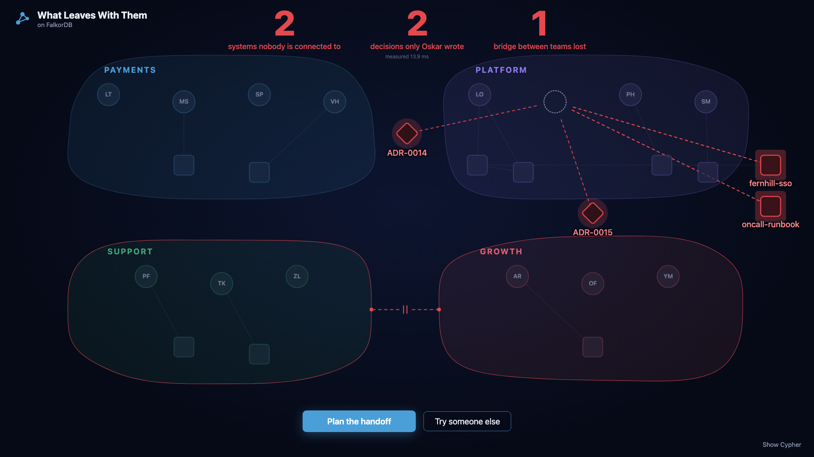
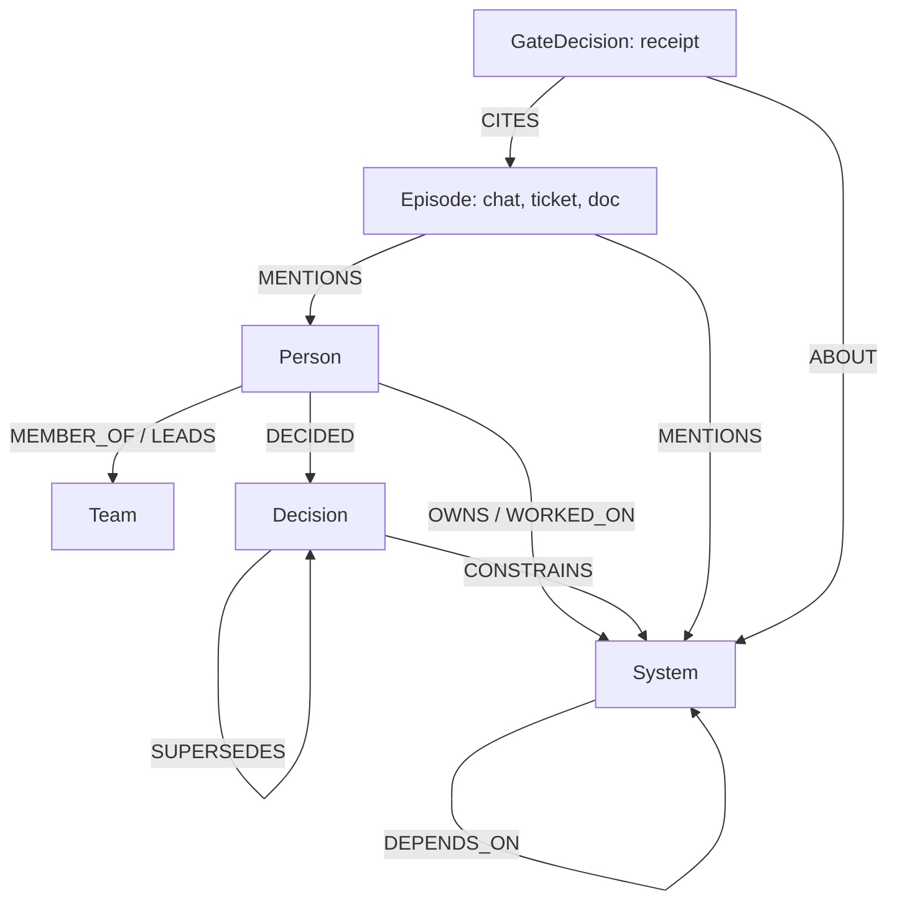

# What Leaves With Them

[](https://github.com/retailbox-automation/what-leaves-with-them/actions/workflows/tests.yml) on FalkorDB 6.0.2 and 4.22 · MIT

When someone leaves a company, the agent shows what leaves with them and builds the handoff, every line with a graph path back to its source records. It walks a company graph in FalkorDB from the person to the decisions they made, the systems those decisions constrain, the people and teams who own those systems, and the things nobody else is connected to once the person is gone.

In a 2022 survey of 1,000 IT managers at large organizations in the UK and US, 67% said they were concerned about losing knowledge and expertise when people leave, and 64% said their organization had already lost knowledge that way ([Sinequa press release, August 2022](https://www.sinequa.com/company/press/sinequa-finds-over-two-thirds-of-it-leaders-are-concerned-by-organizational-knowledge-loss-from-employee-turnover/)). We built it because people left our own team and took knowledge with them.

**Try it: https://what-leaves.retailbox-automation.com**. Pick a person, move the depth slider from 1 to 4, press Remove, then Plan the handoff and answer the leaver's questions before the notice period runs out. Show Cypher lists every query the last step ran, with its time. Writes are locked on the public demo.

**Watch it (2:15): https://youtu.be/0_gOiEaffRw**

<a href="https://what-leaves.retailbox-automation.com"></a>

Built for Graph Hacks (FalkorDB and WeMakeDevs, October 2026). Main track: **03 Company Brain**. Also entered: **02 Agent Memory and Coordination**.

## What the graph does here

Every step is a Cypher query or a graph algorithm on FalkorDB. A join or a text search gives the first row; the rest needs the graph. Results from the seed-42 walkthrough in [docs/DEMO-N5.md](docs/DEMO-N5.md) (FalkorDB 6.0.2), for the leaver Oskar Alvarez:

| Step | What FalkorDB does | Result |
|---|---|---|
| Depth 1 | `(person)-[:OWNS\|LEADS\|MEMBER_OF]->(x)`: what a join would list | 3 items: fernhill-sso, oncall-runbook, team Platform |
| Depth 4 | `(person)-[:DECIDED]->(d)-[:CONSTRAINS]->(x)`, then `(s)-[:DEPENDS_ON*0..2]->(x)` and each system's owner | 7 more systems at risk, reaching all 4 teams |
| Remove | the graph is copied without the person into a temporary graph; `algo.WCC` finds parts that no person is connected to | 2 islands: fernhill-sso and oncall-runbook; 6.3 ms including building and dropping the copy |
| Bridges | `algo.betweenness` over people, teams and systems | Oskar Alvarez ranks first (290.28) and is the only person linking Growth and Support |
| Single source | for each item, the authors of every source record behind every fact about it | decisions resting only on his records: 2 the day before the handoff session, 0 after it |
| Handoff plan | the queries above combined, with candidates and questions for the leaver | 2 handoff lines and 3 questions; one asks about promises made on calls, which no record can hold |

On the same records, plain retrieval answered 0% of the benchmark's depth-4, what-if, bridge, successor and handoff-plan questions (8 questions; [bench/RESULTS.md](bench/RESULTS.md), by question type).

## Contents

- [The demo story](#the-demo-story)
- [How the memory stays honest: the write gate](#how-the-memory-stays-honest-the-write-gate)
- [Cypher the product depends on](#cypher-the-product-depends-on)
- [Graph data model](#graph-data-model)
- [Benchmark](#benchmark)
- [Red team of the write gate](#red-team-of-the-write-gate)
- [Run it locally](#run-it-locally)
- [Notes for the FalkorDB team](#notes-for-the-falkordb-team)
- [How this maps to the tracks and rules](#how-this-maps-to-the-tracks-and-rules)
- [Known limits](#known-limits)
- [How AI was used](#how-ai-was-used)

## The demo story

The data is a fictional company, Quillfield Billing, generated by a seeded script ([data/MANIFEST.md](data/MANIFEST.md)). Oskar Alvarez (Platform) resigns on 2026-09-25 (DOC-15); his last day is 2026-10-09 (DOC-16). Every line below is printed by `examples/departure_demo.py` into [docs/DEMO-N5.md](docs/DEMO-N5.md); nothing is typed in by hand.

1. **Depth 1 vs depth 4.** At depth 1 he owns fernhill-sso (a customer integration) and oncall-runbook and is a member of Platform. At depth 4 the graph follows ADR-0014, ADR-0015 and ADR-0016 to 7 more systems, owned by people in Payments, Growth, Support and Platform.
2. **Without him.** Nobody else in the graph is connected to fernhill-sso or oncall-runbook.
3. **Bridges.** He is the only person linking Growth and Support.
4. **Successors are candidates, not decisions.** For fernhill-sso: Lars Thorne, Pavel Hollis, Sana Petrov (by their work on auth, which fernhill-sso depends on). For oncall-runbook: no one in the graph has worked on it.
5. **The honest not-in-graph.** "Did Oskar Alvarez promise Fernhill Outfitters anything on a phone call after resigning?" The answer is `not_in_graph`: 10 records searched, and phone calls and meetings are not channels this memory receives.
6. **The handoff session.** Oskar writes DOC-17 and his named successor Viktor Hartwell confirms in DOC-18. Both pass through the same write gate as `CONFIRM`s that add a second author to facts the graph already holds. Decisions resting only on his records go from 2 to 0. Systems stay at 2: his notes on fernhill-sso still wait for a second person, and nobody else has touched the on-call runbook.
7. **The last day.** DOC-16 arrives through the gate as three `CLOSE`s. Asked "who owns fernhill-sso now?", the memory answers: "fernhill-sso has no current owner. Last owner: Oskar Alvarez until 2026-10-09 (closed by GD-00225-e5a583243b, citing DOC-16). Nobody has been recorded as taking it over." It does not guess.

The same tools work before a vacation, a parental leave or a team move. It is a handoff, not surveillance: fictional people only, and the bridge score is the only per-person number.

## How the memory stays honest: the write gate

Every candidate fact passes a gate in plain code before it is stored. A model may propose a fact; it never decides what is stored. Every attempt writes a receipt (a `GateDecision` node that `CITES` the source record), and every answer can be traced to receipts and records.

| Outcome | When | What is written |
|---|---|---|
| `ACCEPT` | a new fact, and one line of a cited record names both ends (and, for most relations, the relation's word) | the typed edge, with `valid_at`, `source_ids`, `gate_id` |
| `CONFIRM` | the fact is already current | the record is added as one more source |
| `SUPERSEDE` | a newer fact replaces the current one (one owner per system, one team per person) | the new edge; the old one moves to `WAS` |
| `CLOSE` | a fact ends without a replacement, such as on a last day | the edge moves to `WAS` with `invalid_at` and the closing receipt |
| `REJECT` | no source, a source that does not state it, personal data, older than the current fact, and more | only the receipt, with the reasons |

Replaying the seed-42 company: 403 records, 226 gate decisions: ACCEPT 108, CONFIRM 110, SUPERSEDE 1, CLOSE 3, REJECT 4 ([bench/RESULTS.md](bench/RESULTS.md)). The checks, in order, are in [docs/ARCHITECTURE.md](docs/ARCHITECTURE.md#write-gate).

**History is an edge type, not a filter.** Closing a fact deletes the typed edge and writes `(s)-[:WAS {predicate, valid_at, invalid_at, source_ids, gate_id, closed_by}]->(o)`. Questions about the present never touch history. On 20k nodes, 200k edges, 30% closed, 4 hops ([docs/sponsor-feedback.md](docs/sponsor-feedback.md), item 4):

| Layout | FalkorDB 6.0.2 median | FalkorDB 4.22 median |
|---|---|---|
| Filter over the path, `WHERE all(x IN relationships(p) WHERE x.invalid_at IS NULL)` | 15.22 ms | 9.27 ms |
| Filter on the relationship right after `MATCH`, `WHERE r.invalid_at IS NULL` | 4.34 ms | 2.17 ms |
| Closed facts moved to another edge type (`WAS`) | 1.48 ms | 1.32 ms |

**One graph per tenant.** A tenant is a different FalkorDB graph (`hm_<tenant>`), not a `WHERE` clause ([honest_memory/schema.py](honest_memory/schema.py), `graph_name`).

## Cypher the product depends on

Agents never write Cypher. They pick from a fixed catalogue of 21 tools, each a human-written, parameterised query; every name in the arguments is resolved against the graph first ([docs/ARCHITECTURE.md](docs/ARCHITECTURE.md#tool-catalogue) has the whole catalogue with its queries). The same catalogue reaches the HTTP API, the MCP server and the agent. Three of the queries, copied from [honest_memory/departure.py](honest_memory/departure.py):

**Run them yourself:** [queries/](queries/) holds the exact statements the departure tools run for the demo's leaver (what_leaves at depth 1 and 4, single_source, the WCC and betweenness projections, successors, promises, the handoff plan), each with its parameters in FalkorDB's `CYPHER name=value` header, so it pastes into FalkorDB Browser or `redis-cli GRAPH.QUERY`. The files are written from the tools' own traces by `scripts/export_queries.py`; `tests/test_queries.py` checks they have not drifted and runs every statement on both engines against its recorded row count.

Depth 2 to 4: decisions the person made that govern systems others own, and what depends on those systems. `{k}` is depth minus 2, validated in code, because neither engine takes a variable-length bound as a parameter ([FalkorDB #3350](https://github.com/FalkorDB/FalkorDB/issues/3350)).

```python
_DECIDED_REACH = (
    "MATCH (me:Person {{name: $person}})-[dec:DECIDED]->(d:Decision)-[c:CONSTRAINS]->(x:System) "
    "WHERE dec.valid_at <= $t AND c.valid_at <= $t AND NOT d.id IN $replaced "
    "MATCH up = (s:System)-[:DEPENDS_ON*0..{k}]->(x) "
    "RETURN d.id, x.name, s.name, length(up), [n IN nodes(up) | n.name], [r IN relationships(up) | r.valid_at], "
    "[r IN relationships(up) | r.source_ids], dec.source_ids + c.source_ids")
```

Single source: every live decision the person made, with the authors of every source record behind any fact about it. A decision whose only author is the person rests on them alone.

```python
_LONE_DECISIONS = (
    "MATCH (me:Person {name: $person})-[mine:DECIDED]->(d:Decision) "
    "WHERE mine.valid_at <= $t AND NOT d.id IN $replaced "
    "MATCH (x)-[r:DECIDED|CONSTRAINS|SUPERSEDES]-(d) WHERE r.valid_at <= $t "
    "UNWIND r.source_ids AS sid "
    "MATCH (e:Episode {id: sid}) WHERE e.ts <= $t "
    "RETURN d.id, d.title, collect(DISTINCT e.author), collect(DISTINCT e.id) ORDER BY d.id")
```

Islands and bridges: both run on a temporary projection graph (`hm_<tenant>__<purpose>_<random>`, always deleted). For `without`, the person is left out of the copy; for `bridges`, every link is written both ways, because `algo.betweenness` follows edge direction and has no option to ignore it.

```python
_WCC = ("CALL algo.WCC({nodeLabels: ['Person', 'Team', 'System', 'Decision'], relationshipTypes: ['LINK']}) "
        "YIELD node, componentId RETURN labels(node)[0], node.key, componentId")
_BETWEENNESS = ("CALL algo.betweenness({nodeLabels: ['Person', 'Team', 'System'], relationshipTypes: ['LINK'], "
                "samplingSize: $n, samplingSeed: $seed}) YIELD node, score RETURN labels(node)[0], node.key, score")
```

## Graph data model

Full model and every record edge: [docs/ARCHITECTURE.md](docs/ARCHITECTURE.md#graph-model).



A closed fact keeps its ends and moves to a `WAS` edge. The departure tools walk `DECIDED`, `CONSTRAINS` and `DEPENDS_ON` from the person, and every answer carries the `Episode` ids on the edges it used.

| Node | Key | Holds |
|---|---|---|
| `Person`, `Team`, `System`, `Decision` | name or id | the company; a `System` can be a service, a customer integration or a runbook; a `Decision` is an ADR, accepted or superseded |
| `Episode` | id | one source record: chat message, ticket or document, with author and time |
| `GateDecision` | id | the receipt of every write attempt, accepted or refused |
| `Agent`, `Finding`, `Handoff` | name or id | what agents concluded and passed to each other |

| Edge | From -> to | Meaning |
|---|---|---|
| `OWNS` | Person -> System | one current owner per system |
| `MEMBER_OF`, `LEADS` | Person -> Team | one current team per person, one lead per team |
| `WORKED_ON` | Person -> System | with a `count` of work items |
| `DECIDED` | Person -> Decision | who made the decision |
| `SUPERSEDES` | Decision -> Decision | a decision replaced by a later one |
| `CONSTRAINS` | Decision -> System | the decision governs how the system must work |
| `DEPENDS_ON` | System -> System | a dependency |
| `WAS` | any of the above | a closed fact, with `predicate`, `valid_at`, `invalid_at`, `source_ids`, `closed_by` |
| `MENTIONS`, `REFERS_TO`, `CITES`, `ABOUT`, `WROTE`, `DERIVED_FROM`, `FROM`, `TO` | records and receipts | where every fact and finding came from |

Current facts carry `valid_at`, `source_ids` and `gate_id`.

## Benchmark

82 questions about the synthetic company, seed 42, the same local model for the two systems that use one, scored by names and dates with no model as judge ([bench/RESULTS.md](bench/RESULTS.md), method and limits in [bench/README.md](bench/README.md)):

| System | Correct % | Stale % | Unsupported % | No answer % | Personal-data leaks | Median ms |
|---|---|---|---|---|---|---|
| Plain RAG (top 8 records by embedding) | 46.3 | 4.9 | 0.0 | 36.6 | 2 | 512 |
| Graph tools, rule router (no model) | 100.0 | 0.0 | 0.0 | 0.0 | 0 | 2 |
| Graph tools, LLM agent | 95.1 | 0.0 | 0.0 | 1.2 | 0 | 784 |

- Plain RAG's stale answers give Growth as the owner of billing-api from an unsourced chat message, list a dependency before it existed, or say Oskar Alvarez "owns fernhill-sso" after his last day. Its 2 leaks repeat a phone number and a mailing address planted in a ticket, which the gate refuses to store.
- The agent's 95.1% comes after three general prompt rules that were written after reading its misses on this same question set (before them: 90.2%), so treat it as close to an upper bound for this corpus. Both runs are in the git history.
- The router's rules were written against this question set, so its 100.0% says little about other phrasings. The agent, where the model picks the tool, is the fairer comparison.
- One seed, one model, one run per setting, no confidence intervals. The strongest baseline variant tried (one line per retrieval unit, k = 16) reaches 58.5% ([bench/SENSITIVITY.md](bench/SENSITIVITY.md)).

## Red team of the write gate

36 attacks on the gate: missing or forged sources, backdated and future-dated claims, personal data in many forms, Cypher and homoglyphs in names, memory poisoning, forged last-day records ([redteam/REPORT.md](redteam/REPORT.md)). The expected outcome of each of the 30 original attacks was written before the first run and never changed.

| Run | FalkorDB 4.22.0 | FalkorDB 6.0.2 |
|---|---|---|
| First run, gate as found | 13/36 (11 of the 30 original, 2 of the 6 on the last-day path) | 13/36 |
| After 11 fixes | 36/36 | 36/36 |

Found, then fixed (each fix has its commit in the report):

- A card number written with dots, an email spelled `name [at] host [dot] tld`, and a phone number used as an agent name were stored. The patterns now cover those forms, and agent, session and party names are scanned too.
- A record titled "Last day: Pavel Hollis" whose only line was about Lars Thorne ended Pavel's ownership. An end now needs one line that names both ends and says "no longer".
- An episode dated 2030 was stored and would have won every later "newer than the current fact" test. Episodes more than an hour ahead of the clock are now refused.
- 50 identical claims wrote 50 receipts. An exact repeat now bumps a counter on the first receipt.

## Run it locally

Needs Python 3.12 and Docker. Everything below was run from a clean clone on FalkorDB 6.0.2 and 4.22.0.

```bash
git clone https://github.com/retailbox-automation/what-leaves-with-them.git
cd what-leaves-with-them
python3.12 -m venv .venv && . .venv/bin/activate
pip install -e '.[api,mcp,agent]'

# FalkorDB 6.0.2, or falkordb/falkordb:v4.22.0 (the version FalkorDB Cloud free runs); both are tested
docker run -d --rm --name falkordb -p 6379:6379 falkordb/falkordb:6.0.2
export FALKORDB_PORT=6379            # the host port you mapped

# the synthetic company (seed 42) through the write gate into tenant "quillfield"
python -m honest_memory.corpus --seed 42 --out data/corpus
python -m honest_memory.ingest --corpus data/corpus/42 --tenant quillfield --reset

# HTTP API and the panel
uvicorn honest_memory.api:app --port 8080
```

Open http://localhost:8080 for the panel, or call a tool from another shell:

```bash
curl -s -X POST localhost:8080/v1/quillfield/tools/what_leaves \
  -H 'content-type: application/json' -d '{"person": "Oskar Alvarez", "depth": 4}'
curl -s -X POST localhost:8080/v1/quillfield/ask \
  -H 'content-type: application/json' -d '{"question": "Who owns fernhill-sso now?"}'
```

Endpoints: `GET /health`, `GET /v1/{tenant}/tools`, `POST /v1/{tenant}/tools/{name}`, `POST /v1/{tenant}/ask`, `GET /v1/{tenant}/graph`, `GET /v1/{tenant}/receipts`, `POST /v1/{tenant}/episodes`, `GET /v1/{tenant}/episodes/{id}` ([honest_memory/api.py](honest_memory/api.py)). Locally, writes are open unless `HM_WRITE_TOKEN` is set; the public demo locks them ([docs/DEPLOY.md](docs/DEPLOY.md)).

**MCP server.** Any MCP client (a code editor or an agent) can use the same 21 tools over stdio. Example client configuration; more in [docs/MCP.md](docs/MCP.md):

```json
{
  "mcpServers": {
    "what-leaves": {
      "command": "/absolute/path/to/what-leaves-with-them/.venv/bin/python",
      "args": ["-m", "honest_memory.mcp_server"],
      "env": { "HM_TENANT": "quillfield", "HM_AGENT": "agent:editor", "FALKORDB_HOST": "localhost", "FALKORDB_PORT": "6379" }
    }
  }
}
```

**The agent** runs on a local open model through [Ollama](https://ollama.com); no paid API and no key. The default model is `DEFAULT_MODEL` in [honest_memory/agent.py](honest_memory/agent.py). With Ollama running:

```bash
MODEL="$(python -c 'from honest_memory.agent import DEFAULT_MODEL; print(DEFAULT_MODEL)')"
ollama pull "$MODEL"
HM_LLM_MODEL="$MODEL" HM_LLM_REASONING=none python -m honest_memory.agent ask "Which decisions of Oskar Alvarez govern systems that other teams own?" --tenant quillfield
```

Start the API with `HM_LLM_MODEL` set and `POST /ask` uses the model too; without it, the rule router answers. The model picks a tool and fills its arguments; the sentence it writes is checked against the rows, and a sentence built from the rows replaces it when the check fails.

**Examples and tests:**

```bash
python examples/two_agents.py --tenant two-agents --ingest --drop   # two agents, one memory, a fact that changes
python examples/departure_demo.py --ports 6379                     # the walkthrough in docs/DEMO-N5.md; two ports compare engines

pip install -e '.[dev]'
HM_TEST_PORTS=6379 python -m pytest -q    # comma-separated ports run every test on each engine; leave HM_LLM_MODEL unset
```

The benchmark needs Ollama with two models ([bench/README.md](bench/README.md#reproduce)); the red team reproduces with `python redteam/run.py --ports <ports>` ([redteam/REPORT.md](redteam/REPORT.md#reproduce)). The public demo is two containers, FalkorDB v4.22.0 and the API, described in [docs/DEPLOY.md](docs/DEPLOY.md).

## Notes for the FalkorDB team

Eight things we ran into, each with a reproduction (scripts in [spike/](spike/)), in [docs/sponsor-feedback.md](docs/sponsor-feedback.md):

1. A variable-length bound cannot be a query parameter (`*1..$depth`), and the error points elsewhere. Filed as [#3350](https://github.com/FalkorDB/FalkorDB/issues/3350).
2. Cloud free runs 4.22, Docker `latest` is 6.0.x, and code written for one does not always run on the other.
3. Cloud free speaks plain RESP only; with `ssl=True` the client waits forever, with no error.
4. Keeping history as an edge type beats filtering on a timestamp (the table above).
5. A third-party agent-memory library's FalkorDB driver hit errors on both engines (index tasks failing silently on 6.0.2, connection limits, a label expression both parsers reject); we went with direct Cypher.
6. `algo.betweenness` follows edge direction and has no option to ignore it.
7. `algo.betweenness` samples sources: exact on 6.0.2 only with `samplingSize` at least the node count, never exact on 4.22.
8. On 6.0.2, a filter after `OPTIONAL MATCH ... WITH x, count(...) AS c WHERE ...` sees the next `MATCH`'s node as null. Filed as [#3351](https://github.com/FalkorDB/FalkorDB/issues/3351).

## How this maps to the tracks and rules

| Track or rule | Where in the repo | Evidence |
|---|---|---|
| 03: knowledge from docs, tickets and chats in one graph | [honest_memory/ingest.py](honest_memory/ingest.py), [data/MANIFEST.md](data/MANIFEST.md) | 225 chat messages, 127 tickets and 51 documents become `Episode` nodes that `MENTIONS` the people, teams, systems and decisions they name |
| 03: who owns what, and who knows what | `current_owner`, `who_knows`, `what_leaves` in [honest_memory/tools.py](honest_memory/tools.py) and [honest_memory/departure.py](honest_memory/departure.py) | on the 10 `who_knows` questions: router and agent 100.0%, plain RAG 0.0% ([bench/RESULTS.md](bench/RESULTS.md)) |
| 03: tracing decisions back to their source | `decision_trail`, `why`, `single_source`; `GateDecision -CITES-> Episode` | every answer returns paths, sources and receipts ([docs/ARCHITECTURE.md](docs/ARCHITECTURE.md#answers)) |
| 03: keeping knowledge current as things change | the write gate ([honest_memory/gate.py](honest_memory/gate.py)): `SUPERSEDE`, `CLOSE`, `WAS` | 0.0% stale for router and agent, 4.9% for plain RAG ([bench/RESULTS.md](bench/RESULTS.md)); after the last day, "no current owner" instead of a guess ([docs/DEMO-N5.md](docs/DEMO-N5.md), section 9c) |
| 03: answers with clear sources | four answer outcomes: `answered_with_path`, `answered_from_memory`, `not_in_graph`, `unknown_entity` | the model's sentence is checked against the rows ([honest_memory/answer.py](honest_memory/answer.py)); 0.0% unsupported for all three systems |
| 03: "gets work done" | `handoff_plan` in [honest_memory/departure.py](honest_memory/departure.py) | a plan with candidates and questions; `propose=true` writes each line as a proposed `Handoff` through the gate, for a person to approve |
| 02: memory that persists across sessions | `remember`, `recall`; `Finding` nodes | [examples/two_agents.py](examples/two_agents.py): a new session of `agent:ops` recalls what `agent:support` left, `answered_from_memory` with the date |
| 02: memory that updates over time | the gate, `WAS` edges | same example: an ownership change arrives, both agents' answers change, the old finding is flagged as older than the change |
| 02: shared state and handoffs between agents | `handoff`; `Handoff -FROM-> Agent`, `-TO-> Agent` | same example; [tests/test_two_agents.py](tests/test_two_agents.py) |
| 02: separate memory per user or tenant | one FalkorDB graph per tenant ([honest_memory/schema.py](honest_memory/schema.py)) | `test_tenants_are_isolated` in [tests/test_store.py](tests/test_store.py) |
| 02: high-concurrency reads and writes | | not measured |
| Rules 2 and 3: FalkorDB is the primary database and does real work | every tool is Cypher or a graph algorithm on FalkorDB; there is no other store | without FalkorDB there is no answer; the panel can only replay answers recorded from it ([web/fixtures/](web/fixtures/)) |
| Rule 6: allowed data | [data/MANIFEST.md](data/MANIFEST.md) | synthetic only, generated by a seeded script with no network |
| Rule 8: work starts after the opening | `git log --reverse`, [docs/design-sketch.md](docs/design-sketch.md) | first commit 2026-10-14 14:31 -04:00 (18:31 UTC, the opening); the pre-start design sketch has no code |
| Rule 10: setup, data model, Cypher, live deployment, track | this README, [docs/ARCHITECTURE.md](docs/ARCHITECTURE.md), https://what-leaves.retailbox-automation.com | tracks 03 and 02; demo video https://youtu.be/0_gOiEaffRw |
| Rule 11: AI disclosure | [How AI was used](#how-ai-was-used) | |

## Known limits

- **Synthetic, single-domain corpus.** One fictional company of 403 records, written by a seeded script with the failure modes (rumour, stale runbook, personal data, ownership transfer, a person leaving) put in on purpose. It shows the mechanism works where it should; it does not predict a rate on real data ([bench/README.md](bench/README.md#limits)).
- **The router's rules were written for this question set.** The agent is the fair comparison, and its prompt rules were also tuned after reading its misses (see [Benchmark](#benchmark)).
- **Who may write a last-day record is not checked.** The gate checks that the record says the fact ended and that the date fits, not that the author is the person, their lead or HR. The public demo has writes locked ([redteam/REPORT.md](redteam/REPORT.md#known-limits)).
- **Personal-data detection is a heuristic.** It stops the obvious and accidental forms; some spellings still pass, listed in [redteam/REPORT.md](redteam/REPORT.md#known-limits).
- **The demo does not run on FalkorDB Cloud free.** Free instances that are not used for 1 day are stopped ([FalkorDB docs](https://docs.falkordb.com/cloud/tiers/free)), so the demo runs FalkorDB v4.22.0, the Cloud free version, in a container ([docs/DEPLOY.md](docs/DEPLOY.md)).

## How AI was used

The code, tests and docs in this repository were written with AI coding assistants under the author's direction. The design decisions, the choice of concept and the acceptance of each change are the author's. The demo agent itself runs on a local open model, with no paid API. The narration of the demo video is an AI clone of the author's own voice.

## Repository

| Path | What |
|---|---|
| [honest_memory/](honest_memory/) | the memory: write gate, ingest, tool catalogue, departure tools, agent, HTTP API, MCP server |
| [web/](web/) | the one-page panel, static files over the HTTP API |
| [queries/](queries/) | the departure tools' Cypher with parameters, generated from their traces and run by the tests |
| [bench/](bench/) | the benchmark against plain retrieval |
| [redteam/](redteam/) | the 36 attacks on the write gate and their report |
| [examples/](examples/) | the departure walkthrough and the two-agent memory demo |
| [spike/](spike/) | reproductions for the notes to the FalkorDB team |
| [docs/](docs/) | architecture, demo walkthrough, deploy, MCP, notes for FalkorDB, panel screenshots |

## License and team

MIT ([LICENSE](LICENSE)). Built by [RetailBox Automation](https://retailbox-automation.com).
